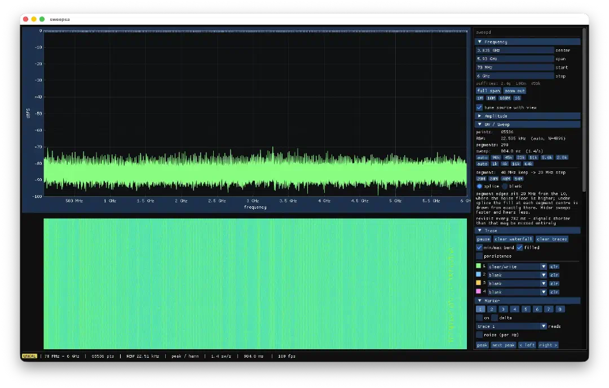
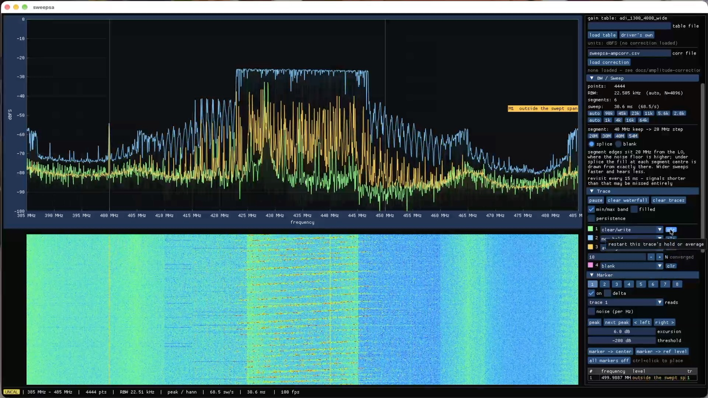

[English](README.md) | [简体中文](README.zh-CN.md)

# sweepsa





[](https://www.youtube.com/watch?v=LSbwSFtaknI)

> Formerly `sweepsa-releases`. Old links redirect here.

A swept spectrum analyzer for software-defined radios. On **AD936x boards
running Pluto-style firmware** with a Zynq ARM, it hops the LO with the chip's
**fastlock** profiles from the board's own ARM. The desktop shows an
instrument-style front panel: traces, markers, detectors, derived RBW, hold
modes, a waterfall, and zero span with a video trigger. A **HackRF One** on
your computer's USB works too, using its firmware sweep mode.

This repository holds the source of the desktop front panel (`sweepui`), the
libraries it shares with the board-side daemon, and the **binary releases**.
Download one from [Releases](../../releases).

| archive | contents |
|---|---|
| `sweepsa-<ver>-macos-arm64.tar.gz` | `sweepui`, `sweep_client`, `launch.py`, `sweepd` |
| `sweepsa-<ver>-linux-x86_64.tar.gz` | `sweepui`, `sweep_client`, `launch.py`, `sweepd` |
| `sweepsa-<ver>-windows-x86_64.zip` | `sweepui.exe`, `sweepd` |
| `sweepsa-<ver>-sweepd-armv7.tar.gz` | `sweepd` alone, for the board |
| `sweepsa-<ver>-sweepd-relink-kit.tar.gz` | LGPL relink kit for `sweepd` (see below) |
| `libusb-<ver>-source.tar.bz2` | source of the libusb shipped with the macOS and Windows builds |

## Quick start

```sh
tar xzf sweepsa-*-macos-arm64.tar.gz && cd sweepsa-*-macos-arm64
xattr -dr com.apple.quarantine .     # macOS only: these builds are not notarized
./sweepui                            # synthetic source, no radio needed
pip3 install --user pyserial && ./launch.py   # board on USB: deploy sweepd and connect
```

HackRF One: `./sweepui --hackrf`. libhackrf ships in the macOS and Windows
archives; on Linux install your distribution's `libhackrf0`/`hackrf` package.

`README.txt` in each archive has the details, including how to run by hand
and the macOS USB networking note.

## Sweep speed

Measured on an AntSDR E310 and a LibreSDR (AD936x, Pluto-style firmware):

| span | sweep time |
|---|---|
| 70 MHz – 6 GHz | ~500–800 ms |
| a few hundred MHz | ~10–60 ms |

For comparison, a HackRF One in sweepsa takes ~730 ms for the full span. On a
full span the two land in the same range. What fastlock buys on AD936x boards is
a fast, gapless sweep with 40–56 MHz of bandwidth per segment, run from the
board's own ARM instead of across the USB or network link.

**Not a calibrated instrument.** Levels are dBFS, and an UNCAL badge stays lit,
until you load an amplitude correction.

## Licence

The source in this repository is dual-licensed: **AGPL-3.0**
([LICENSE](LICENSE)), or a **paid commercial licence** if you don't want to
release your own source under the AGPL. Details in [LICENSING.md](LICENSING.md).

The binary releases also contain `sweepd`, which is closed source; see
[LICENSE.txt](LICENSE.txt). `sweepd` is statically linked against libiio and
glibc (LGPL-2.1). The `sweepd-relink-kit` archive in every release holds the
object files, the libiio source and a script to relink against modified
versions of those libraries. The macOS and Windows builds ship libhackrf
(BSD-3-Clause) and libusb (LGPL-2.1) as separate libraries that `sweepui`
loads at run time. Replace them freely; libusb's source is attached to every
release.

## Source code

This repository has the source of:

- `sweepui`, the desktop front panel (Dear ImGui + ImPlot, Linux / macOS / Windows)
- `sweep_client`, `hackrf_probe` and `rtl_probe`, headless tools
- the libraries `sweepui` shares with the daemon, kept under `src/sweepd/`:
  DSP (windows, FFT, detectors), segment plan and stitching, the wire protocol,
  IQ, signal generator and gain-table parsing

`sweepd`, the board-side sweep daemon, is still closed source. Prebuilt
binaries are attached to every release.

### Build

```sh
git clone --recursive https://github.com/zxkmm/sweepsa.git
cd sweepsa
cmake -S . -B build -G Ninja
cmake --build build
ctest --test-dir build        # host tests, no radio needed
./build/sweepui               # synthetic source
```

Optional: libhackrf headers for `--hackrf`, librtlsdr for `--rtl`. Both are
detected at configure time; without them `sweepui` still builds.

## Credit and Disclaimer 
- The fastlock of 9361 idea is from [SDR-X blogpost](https://sdr-x.github.io/starlink-ul-dl-pair-80k-hop-ad9361/)
